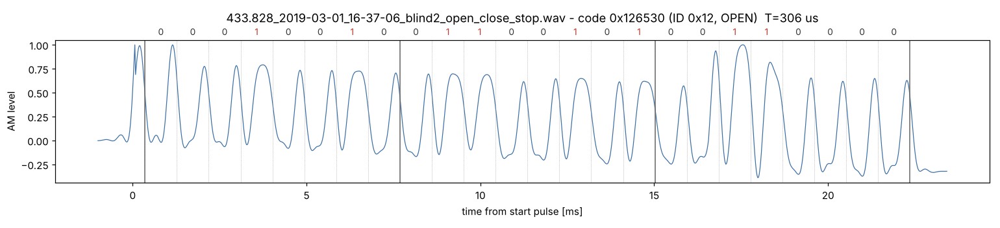
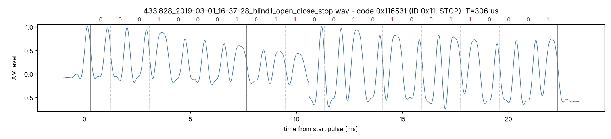

# Data analysis: reverse engineering the blind remote

This folder holds the RF captures of the original 4-channel blind remote and
the script that decodes them. The ESP32 firmware's timing comes from this
analysis (see `src/blinds/rf_protocol.h`).

## Recordings

The recordings were made with an RTL-SDR in AM mode. Each one is a 48 kHz,
16-bit mono WAV of the demodulated audio, so carrier on shows up as a positive
pulse. The file name holds the tuned frequency in MHz and the capture time.

| File | Content | Decoded presses |
|---|---|---|
| `433.828_2019-03-01_16-37-28_blind1_open_close_stop.wav` | Blind 1: open, close, stop | `0x116530`, `0x116532`, `0x116531` |
| `433.828_2019-03-01_16-37-06_blind2_open_close_stop.wav` | Blind 2: open, close, stop | `0x126530`, `0x126532`, `0x126531` |
| `433.828_2019-03-01_16-36-31_blind3_open_close_stop.wav` | Blind 3: open, close, stop | `0x136530`, `0x136532`, `0x136531` |
| `433.828_2019-03-01_16-37-50_blind4_open_close_stop.wav` | Blind 4: open, close, stop | `0x146530`, `0x146532`, `0x146531` |
| `433.840_2019-03-03_21-50-55.wav` | Background noise plus one click at ~1.75 s | None. No valid frame is in this file |

## Protocol

| Property | Value |
|---|---|
| Frequency | ~433.83 MHz, ASK/OOK. A standard 433.92 MHz module works. |
| Base time unit `T` | **306 µs** (measured 305–306 µs, σ < 1 µs) |
| Bit length | 3T = 918 µs |
| Frame | 1 start pulse (HIGH, 1T) followed by 24 data bits, MSB first. That is 22.4 ms. |
| Repetition | Frames repeat every **~46 ms** (≈23.6 ms gap) while the button is held. A short press gave 3–5 frames. |

Each bit is sent as LOW then HIGH, and the bit value is set by the length of
the HIGH part:

```
bit 0:   ______--        LOW 2T, HIGH 1T
bit 1:   ___-----        LOW 1T, HIGH 2T

frame:   -  | bit23 | bit22 | ... | bit0 |  (23.6 ms gap)  | repeat
       start
```

Every bit ends HIGH, so each bit has exactly one rising edge.

### Payload

```
 23            16 15             8 7              0
+----------------+----------------+----------------+
|   blind ID     |      0x65      |  0x30 + cmd    |
+----------------+----------------+----------------+
```

| Blind | ID | Open | Stop | Close |
|---|---|---|---|---|
| 1 | `0x11` | `0x116530` | `0x116531` | `0x116532` |
| 2 | `0x12` | `0x126530` | `0x126531` | `0x126532` |
| 3 | `0x13` | `0x136530` | `0x136531` | `0x136532` |
| 4 | `0x14` | `0x146530` | `0x146531` | `0x146532` |

`cmd` is 0 for open, 1 for stop and 2 for close. The middle byte `0x65`
was the same on every channel of this remote, and no rolling code was used,
so replaying a frame is enough to control a blind. Another remote of the same
brand might use a different middle byte or different IDs. If so, run the
decoder on a capture of that remote and change `FIXED_BYTE` / `BLINDS[]` in
the firmware.

### Example frame

Blind 2, open (`0x126530`). Vertical lines mark byte boundaries:



The amplitude jumps part-way through some frames, for example blind 1 below.
That comes from the SDR's automatic gain control, not from the remote. The
decoder copes with it, as described below.



## Decoder: `decode_blinds.py`

It needs only `numpy`. Plots also need `matplotlib`.

```bash
pip install numpy matplotlib
```

```bash
python3 decode_blinds.py
```

```bash
python3 decode_blinds.py --frames
```

```bash
python3 decode_blinds.py --plot
```

```bash
python3 decode_blinds.py my_capture.wav
```

The first command decodes every WAV in this folder. `--frames` also lists each
decoded frame with its timing and decision margin. `--plot` writes one frame
per file to `plots/`. The last command decodes a new capture of your own.

How it works:

1. **Adaptive slicing.** The threshold is the midpoint of a rolling 2 ms
   min/max window. This follows the AGC and baseline drift, which a fixed
   threshold does not. Quiet stretches are squelched.
2. **Framing.** It looks for a 1T start pulse followed by 24 LOW/HIGH pairs
   whose periods are all within ±30% of each other (3T). This also finds
   frames that are joined to noise.
3. **Bits.** Bit = 1 when `HIGH / (LOW + HIGH) > 0.5`. The ideal values are
   1/3 for a 0 and 2/3 for a 1, so the result does not depend on the exact
   threshold.
4. **Presses.** Repeated frames of one blind less than 250 ms apart are
   grouped into one button press, and a majority vote picks the code.

Output for the included recordings (abridged):

```
433.828_..._blind1_open_close_stop.wav
  Button presses:
    t=  1.948s  0x116530  ID=0x11  OPEN   3/5 frames agree  min spacing 46 ms
    t=  4.094s  0x116532  ID=0x11  CLOSE  3/3 frames agree  min spacing 46 ms
    t=  6.031s  0x116531  ID=0x11  STOP   3/3 frames agree  min spacing 92 ms
  Timing: T = 306 us (sd 0), start pulse 333 us, frame 22.4 ms
...
All codes seen:
  0x116530 ... 0x146532   (all 12 blind/command combinations)
```

A few repeats (for example 2 of the 5 "blind 1 open" frames) decode with one
wrong bit. Those are AGC artefacts in the recording, and the majority vote
removes them. Every press decodes to the expected code.

## Firmware check

`src/test/run_tests.sh` renders the frames the ESP32 firmware sends for
every blind and command as a simulated SDR recording. It then decodes that
recording with this script and checks that all 12 codes come back unchanged.
This tests the firmware encoder against the same analysis as the real remote.
